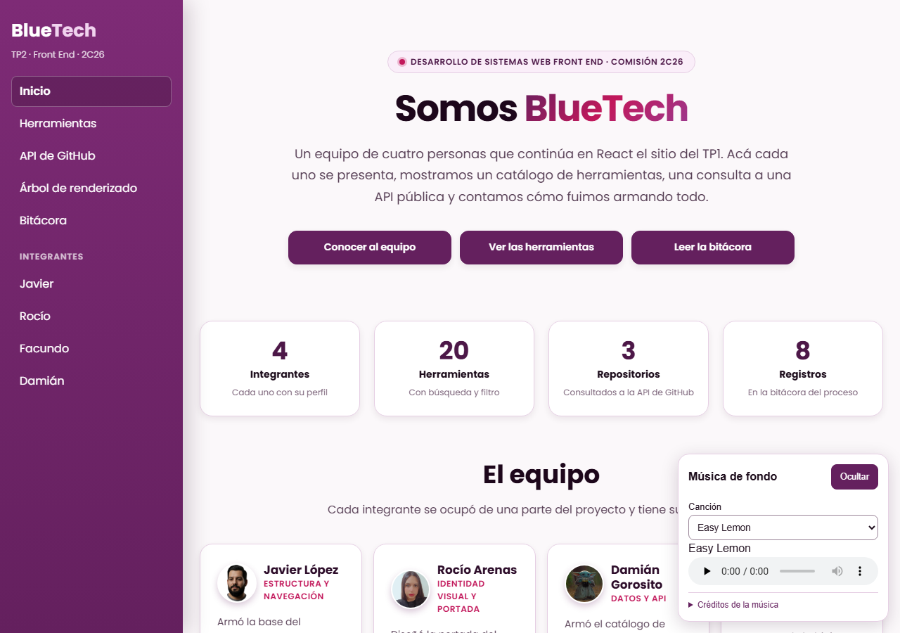
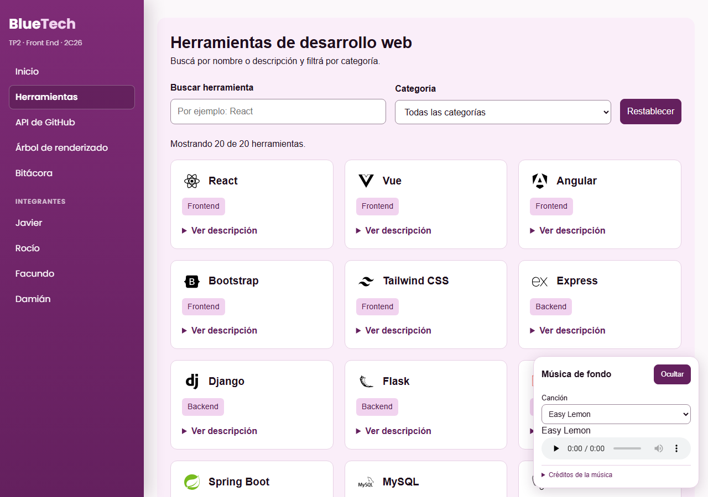
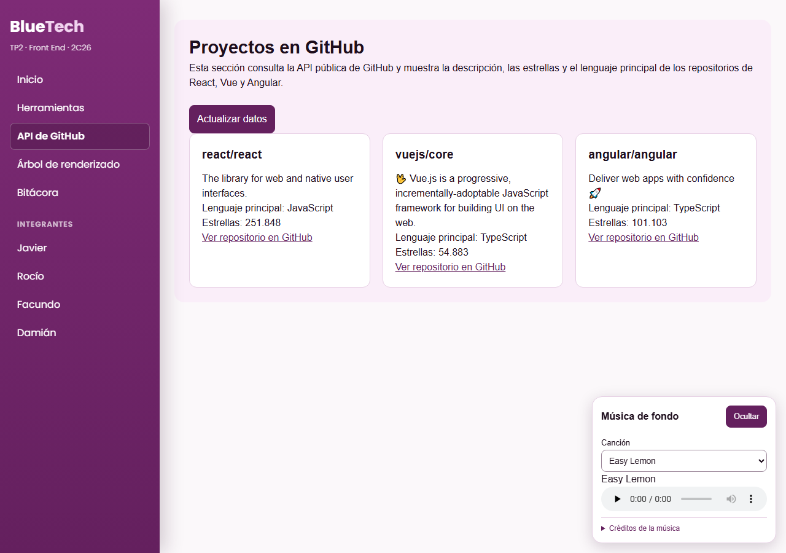
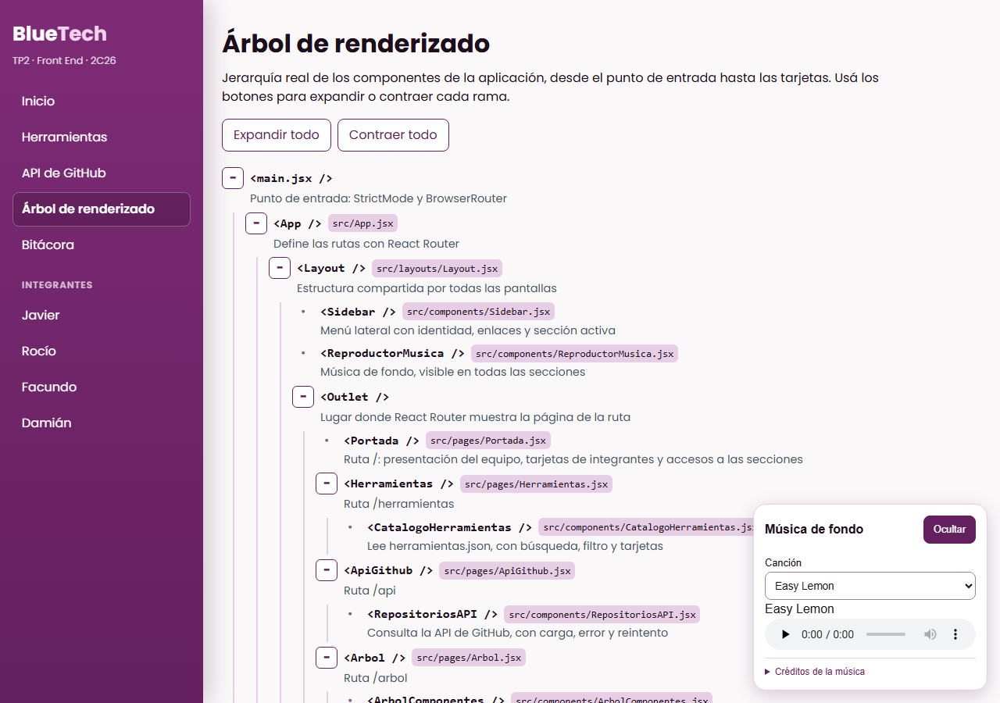
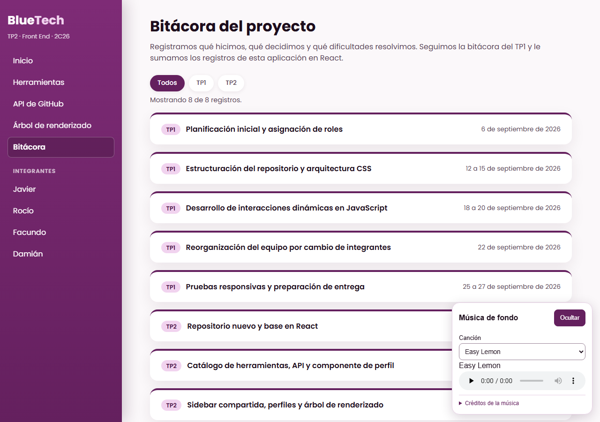
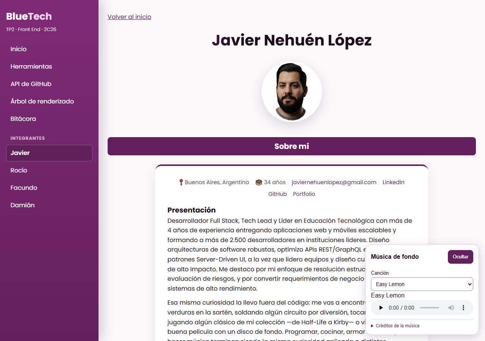

# BlueTech · TP2 Front End

Aplicación en React hecha en equipo para la materia **Desarrollo de Sistemas Web Front End** (comisión 2C26, 2026). Continúa el sitio del TP1: presenta al equipo, un perfil por integrante, un catálogo de herramientas con búsqueda y filtro, una consulta a una API pública, el árbol de componentes y la bitácora del proceso, todo dentro de una sola aplicación con sidebar.

**Sitio publicado:** https://dswf-2-2-c26-front-end-tp-2-t12j.vercel.app/

## Índice

- [Descripción](#descripción)
- [Integrantes](#integrantes)
- [Responsabilidades](#responsabilidades)
- [Secciones de la aplicación](#secciones-de-la-aplicación)
- [Estructura del proyecto](#estructura-del-proyecto)
- [Tecnologías](#tecnologías)
- [Cómo correrlo en local](#cómo-correrlo-en-local)
- [Capturas](#capturas)
- [Uso de IA](#uso-de-ia)

## Descripción

BlueTech es el nombre del equipo. En el TP1 armamos un sitio con HTML, CSS y JavaScript; en este TP lo llevamos a React.

La aplicación se organiza desde una **sidebar compartida** que muestra la identidad del equipo, enlaza a todas las secciones e indica cuál está activa. En el celular se convierte en un panel que se abre y se cierra. Todas las direcciones se pueden abrir y recargar directamente, y las que no existen muestran una página con un enlace para volver.

Los cuatro perfiles salen de **un único componente** (`PerfilIntegrante`) que recibe los datos de cada integrante por props. El contenido de los perfiles viene del TP1.

## Integrantes

| Integrante | GitHub |
|---|---|
| Javier Nehuén López | [Jableed43](https://github.com/Jableed43) |
| Rocío Ailen Arenas | [rocioailenar](https://github.com/rocioailenar) |
| Facundo Sánchez | [FacundoAreo](https://github.com/FacundoAreo) |
| Damián Gorosito | [damiangorosito](https://github.com/damiangorosito) |

## Responsabilidades

| Integrante | A cargo de |
|---|---|
| Javier | Estructura del proyecto, sidebar, navegación con React Router, publicación en Vercel y árbol de renderizado |
| Rocío | Identidad visual (paleta borgoña) y portada |
| Damián | Catálogo de herramientas (JSON), búsqueda y filtro, consulta a la API de GitHub, componente de perfil y reproductor de música |
| Facundo | Bitácora, README y declaración de uso de IA |

Cada integrante tiene además su propio perfil.

## Secciones de la aplicación

| Ruta | Sección | Qué contiene |
|---|---|---|
| `/` | Portada | Presentación del equipo, números del proyecto, tarjetas de cada integrante con un desplegable y accesos a las secciones. |
| `/herramientas` | Herramientas | 20 registros desde `herramientas.json`, con icono, búsqueda por texto, filtro por categoría, contador, aviso de "sin resultados", botón para restablecer y descripción desplegable. |
| `/api` | API de GitHub | Consulta a la API pública de GitHub (sin claves) para mostrar descripción, lenguaje y estrellas de los repositorios de React, Vue y Angular. Tiene mensaje de carga, mensaje de error y botón para actualizar o reintentar. |
| `/arbol` | Árbol de renderizado | Jerarquía real de componentes, que se puede expandir y contraer. |
| `/bitacora` | Bitácora | Registros del TP1 y del TP2 en desplegables, con filtro por etapa. |
| `/integrantes/javier` `/integrantes/rocio` `/integrantes/facundo` `/integrantes/damian` | Perfiles | Presentación, habilidades con filtro, carruseles de películas y discos con video y reproductor, y juegos con ficha desplegable. |

El reproductor de música flotante está disponible en todas las secciones.

## Estructura del proyecto

```
├── index.html
├── vercel.json              reescritura a index.html para poder recargar cualquier ruta
├── public/
│   ├── audio/               música del reproductor
│   └── img/                 avatares por integrante e iconos de las herramientas
├── docs/capturas/           capturas usadas en este README
└── src/
    ├── main.jsx             punto de entrada (StrictMode y BrowserRouter)
    ├── App.jsx              definición de las rutas
    ├── index.css            colores y estilos globales
    ├── layouts/
    │   └── Layout.jsx       estructura común: sidebar, contenido y reproductor
    ├── pages/               una página por ruta (Portada, Herramientas, ApiGithub, Arbol, Bitacora, NoEncontrada)
    ├── components/          Sidebar, PerfilIntegrante, CatalogoHerramientas, RepositoriosAPI,
    │                        ArbolComponentes, BitacoraRegistros y ReproductorMusica
    └── data/                herramientas.json, bitacora.js, arbolComponentes.js y los datos de cada perfil
```

El detalle de cómo se relacionan los componentes está en la sección **Árbol de renderizado** de la propia aplicación.

## Tecnologías

- React 19 y React Router 7
- Vite
- CSS con variables (sin librerías de estilos)
- Iconos SVG de las herramientas (los del TP1 y algunos de [Devicon](https://devicon.dev/))
- Git y GitHub, con una rama por integrante y revisión antes de integrar a `main`
- Vercel para la publicación

La música del reproductor son tres temas de Kevin MacLeod ([Incompetech](https://incompetech.com/)), con licencia [Creative Commons Atribución 4.0](https://creativecommons.org/licenses/by/4.0/). Los créditos también están en el propio reproductor.

## Cómo correrlo en local

```bash
npm install
npm run dev
```

Después abrir la dirección que indica la terminal (por defecto `http://localhost:5173`).

Otros comandos:

```bash
npm run lint
npm run build
```

## Capturas

**Portada**



**Herramientas y API de GitHub**





**Árbol de renderizado y bitácora**





**Perfil**



## Uso de IA

Cada integrante completa su fila con la aplicación que usó, el modelo y para qué tareas.

| Integrante | Aplicación | Modelo | Contenido o tarea |
|---|---|---|---|
| Javier | _a completar_ | _a completar_ | _a completar_ |
| Rocío | _a completar_ | _a completar_ | _a completar_ |
| Damián | _a completar_ | _a completar_ | _a completar_ |
| Facundo | _a completar_ | _a completar_ | _a completar_ |
